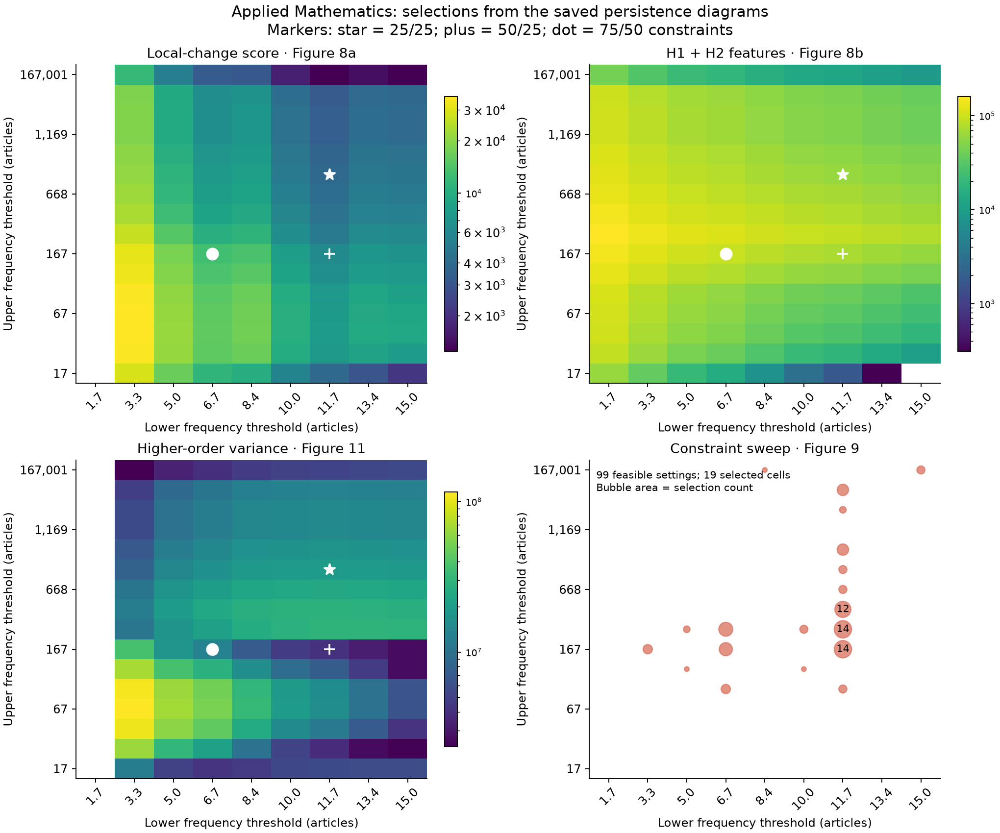

# Higher-order network selection: replication and example

This repository reproduces key analyses in *Higher-Order Network Structure Inference: A Topological Approach to Network Selection*, by Adam Schroeder, Russell Funk, Jingyi Guan, Taylor Okonek and Lori Ziegelmeier. The method selects network thresholds by minimizing changes in a persistent-homology representation, subject to minimum counts of cycles and cavities.

Three short scripts serve two purposes. The manuscript analyses check the reported threshold selections, higher-order variance and comparisons with ten alternative methods using saved numerical inputs. A separate workplace-contact example starts with open observations and runs the complete network-to-selection calculation. All inputs needed by these scripts are included.

## Run

Use Python 3.12. From this directory:

```sh
python3.12 -m venv .venv
source .venv/bin/activate
python -m pip install -r requirements.txt
python reproduce.py
python comparisons.py
python contact_demo.py
```

On Windows, activate with `.venv\Scripts\activate`. The requirements install the bundled HONS 0.1.0 wheel and fixed dependency versions. Each script writes to `output/` and replaces its own previous results. Figures use one PNG per analysis; CSV files provide the underlying numbers.

## What the manuscript analyses reproduce

| Script and output | Manuscript analysis | What is calculated |
| --- | --- | --- |
| `reproduce.py` → `applied_math.png`, `applied_math_grid.csv`, `applied_math_selections.csv` | Figures 8, 9 and 11 | Persistence images for 144 Applied Mathematics networks, local-change scores for 128 selectable cells, three highlighted selections, the 100-setting constraint sweep and higher-order variance. |
| `comparisons.py` → `applied_math_comparison.png`, `applied_math_comparison.csv` | Figure 12; four comparison measures in Table F1 | Finite-feature densities and normalized total persistence for HONS and ten alternatives, calculated from saved lifetime counts and network sizes. |
| `comparisons.py` → `cross_field_comparison.png`, `table_F2.csv` | Figure 13 and Table F2 | Within-field comparisons, median ratios, interquartile ranges, sample sizes and win/tie/loss counts, calculated from saved network-level measurements. |

The first analysis tests the selection calculation itself. The comparison analyses then assess the selected networks using the paper's four evaluation measures. Higher-order variance and the comparison measures are separate assessments; HONS minimizes the local-change score.

The Applied Mathematics selections are:

| H1 / H2 constraint percentiles | Lower frequency bound | Upper frequency bound | Feasible networks |
| --- | ---: | ---: | ---: |
| 25 / 25 | 11.69007 | 835.005 | 71 |
| 50 / 25 | 11.69007 | 167.001 | 44 |
| 75 / 50 | 6.68004 | 167.001 | 10 |

Frequency bounds are in article counts and are inclusive. The primary 50/25 selection therefore retains concepts appearing in 12–167 articles. That network ranks third in higher-order variance among the 44 feasible networks and tenth among the 128 selectable networks. The sweep finds 99 feasible settings selecting 19 distinct cells; the 91/91 setting is infeasible.



Grid rows and columns are spaced evenly in this overview; their labels give the actual threshold values used in the calculation. Star, plus and dot mark the three constraint settings above. The mean used for variance includes all 144 networks, while constraints and selections use the 128 eligible cells.

The comparisons use finite features and lifetimes in years. Densities divide H1 counts by retained edges and H2 counts by retained triangles, multiplying by 1,000; normalized persistence uses summed lifetimes with the same denominators. Cross-field ratios pair each alternative with HONS within a field. Zero denominators are undefined. Positive pairs contribute to ratio summaries; defined zero outcomes remain in win/tie/loss counts.

The empirical inputs begin after network construction and persistent-homology computation. These scripts reproduce the downstream calculations, rather than rerunning the proprietary article corpus, the ten filters or the original homology jobs. The lexical neighborhood in Figure 10 and analyses outside the table above are outside this repository's scope. [Data sources and formats](data/SOURCES.md) identify each input and its role.

## Complete example on an open contact network

`contact_demo.py` uses SocioPatterns observations of face-to-face contacts in a workplace. Each record describes two anonymous participants in a 20-second interval. The script sums contact duration for each pair, dates an edge by its first observation and passes the resulting NetworkX graph to HONS.

The search varies the minimum total contact duration from 0 to 5 minutes in 20-second steps. The upper bound stays at the largest observed duration, so the example filters brief contacts while keeping stronger ones. The 0-minute cell supplies a neighbor for the score; selection starts at 20 seconds, where the full observed network remains available. All candidates use the same observation window for temporal normalization.

With constraints `(50, 25)`, HONS selects **2 minutes 40 seconds**, retaining **224 of 755 edges** and all **92 participants**. Five participants become isolated. The selected network has 47 H1 features and no H2 features: the count constraints for this grid are H1 ≥47 and H2 ≥0, so the H2 requirement imposes no restriction. Inspecting the counts alongside the score makes that consequence visible.


The manuscript application selects concept nodes by document frequency; this example uses HONS to select contact edges by total duration. Its topological features describe the clique complex of accumulated pairwise contacts over time. The manuscript analyses above supply the separate comparison of HONS with other methods.

## Data and license

The workplace records are distributed by [SocioPatterns](https://sociopatterns.org/datasets/contacts-in-a-workplace/) under [CC0](https://creativecommons.org/publicdomain/zero/1.0/). Please cite M. Génois et al., “Data on face-to-face contacts in an office building suggest a low-cost vaccination strategy based on community linkers,” *Network Science* 3, 326–347 (2015).

The manuscript inputs contain derived persistence intervals and network-level numerical measurements from the September 2021 Dimensions snapshot. Article records, concept labels and article identifiers are not included. The MIT [license](LICENSE) applies to this repository's code, documentation, original assets and derived numerical files, including the manuscript inputs and the analysis outputs built from them. See [data/SOURCES.md](data/SOURCES.md) for data provenance. Contact Russell Funk at rfunk@umn.edu.
