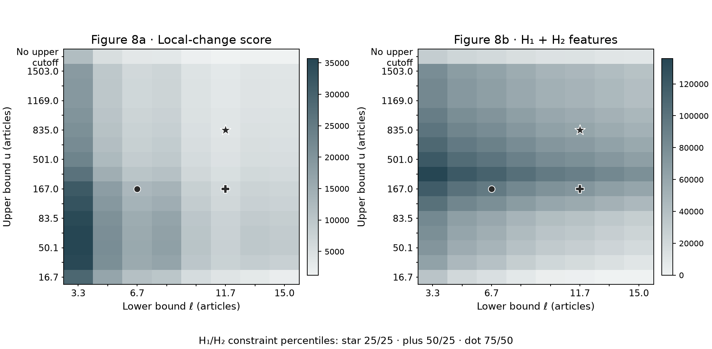
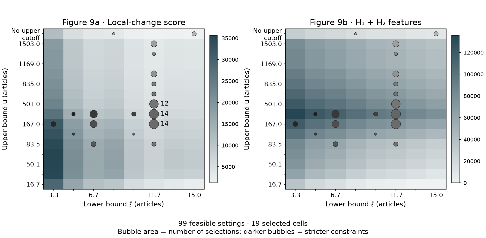
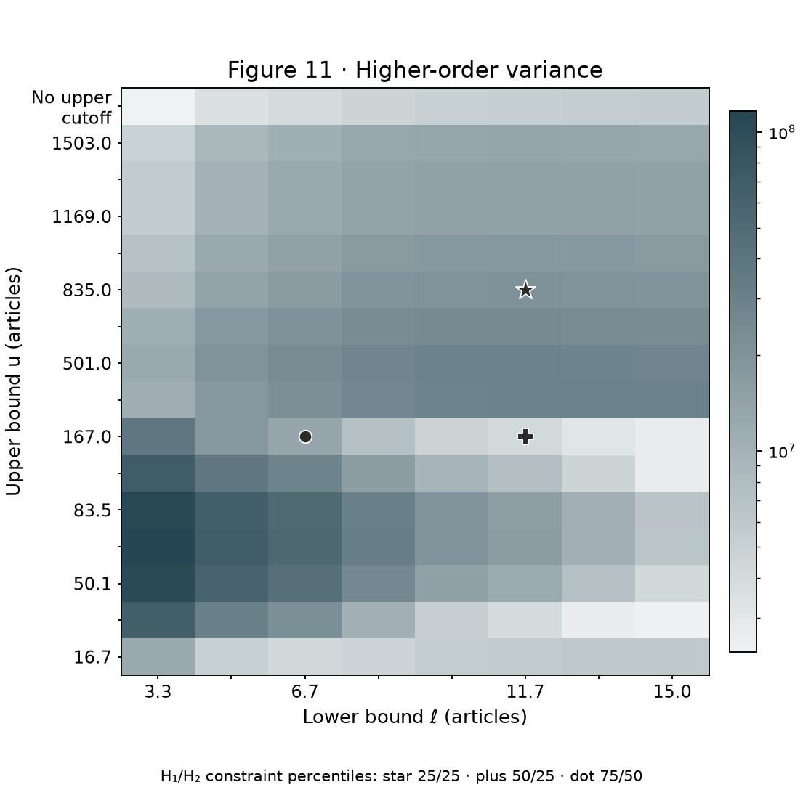
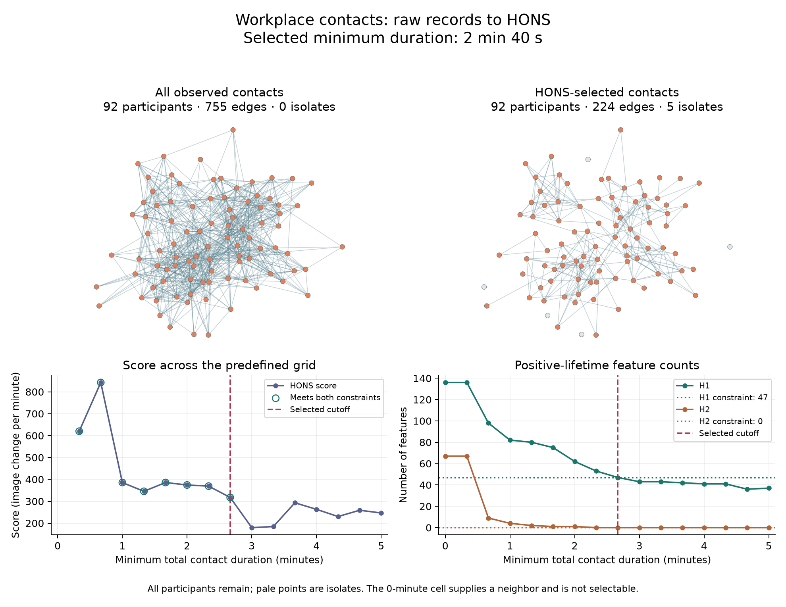

# Higher-order network selection: replication and example

This repository reproduces the threshold selections, higher-order variance analysis and comparisons with ten alternative methods reported in [*Higher-Order Network Structure Inference: A Topological Approach to Network Selection*](https://arxiv.org/abs/2510.04884), by Adam Schroeder, Russell J. Funk, Jingyi Guan, Taylor Okonek and Lori Ziegelmeier. The calculations use the [paper](https://arxiv.org/abs/2510.04884)'s saved persistence diagrams and network measurements. All required inputs are included.

The [HONS package](https://github.com/rfunklab/hons) (higher-order network selection) implements topological thresholding, the method studied in the [paper](https://arxiv.org/abs/2510.04884). The method selects network thresholds by minimizing changes in a persistent-homology representation, subject to minimum counts of cycles and cavities. An additional example starts with open workplace contact records and demonstrates the full calculation, from network construction to edge selection.

## Run the analyses

Use Python 3.12. Clone this repository, install the dependencies and run the three scripts:

```sh
git clone https://github.com/rfunklab/hons-replication.git
cd hons-replication
python3.12 -m venv .venv
source .venv/bin/activate
python -m pip install -r requirements.txt
python reproduce.py
python comparisons.py
python contact_demo.py
```

On Windows, create the environment with `py -3.12 -m venv .venv` and activate it with `.venv\Scripts\activate`. The requirements install the bundled HONS 0.1.0 wheel and fixed dependency versions. Each script writes figures and CSV tables to `output/` and replaces its own previous results.

## Analyses reproduced

Figure and table numbers below refer to the October 2026 revision. The linked [arXiv preprint](https://arxiv.org/abs/2510.04884) currently contains the earlier October 2025 manuscript.

`reproduce.py` recomputes the [paper](https://arxiv.org/abs/2510.04884)'s threshold selections and higher-order variance analysis. `comparisons.py` recomputes the comparisons with ten alternative methods.

| Script and output | Figures and tables in the [paper](https://arxiv.org/abs/2510.04884) | Calculations |
| --- | --- | --- |
| `reproduce.py` → [`applied_math_selections.png`](output/applied_math_selections.png) | Figure 8a–b | Local-change scores and H1 + H2 feature counts, with the three highlighted threshold selections. |
| `reproduce.py` → [`applied_math_sweep.png`](output/applied_math_sweep.png) | Figure 9a–b | The 100-setting constraint sweep overlaid on the score and feature-count heatmaps. |
| `reproduce.py` → [`applied_math_variance.png`](output/applied_math_variance.png) | Figure 11 | Higher-order variance across the 128 selectable networks, calculated relative to the mean over all 144 networks. |
| `comparisons.py` → [`applied_math_comparison.png`](output/applied_math_comparison.png), [`applied_math_comparison.csv`](output/applied_math_comparison.csv) | Figure 12; four comparison measures in Table F1 | Finite-feature densities, normalized total persistence and finite-lifetime profiles for topological thresholding and ten alternatives, calculated from saved feature counts, lifetime sums, survival counts and network sizes. |
| `comparisons.py` → [`cross_field_comparison.png`](output/cross_field_comparison.png), [`table_F2.csv`](output/table_F2.csv) | Figure 13 and Table F2 | Within-field comparisons, median ratios, interquartile ranges, sample sizes and win/tie/loss counts, calculated from saved network-level measurements. |

Reproduction begins with persistence diagrams and measurements computed for the [paper](https://arxiv.org/abs/2510.04884). The scripts recalculate selections and comparison statistics from those inputs. Rebuilding the concept networks from the proprietary Dimensions corpus, running the ten alternative filters and computing the empirical persistence diagrams precede these inputs and are not repeated here. Figure 10's concept neighborhood and analyses outside the table are not included. [Data sources and formats](data/SOURCES.md) describes each input and its preparation.

## Applied Mathematics selections

Topological thresholding minimizes the local-change score subject to minimum cycle (H1) and cavity (H2) counts. The percentile cutoffs are calculated from feature counts across the 128 selectable networks. Higher-order variance and the four comparison measures evaluate the selected networks. The three highlighted constraint settings produce these selections:

| H1 / H2 constraint percentiles | Lower frequency bound | Upper frequency bound | Feasible networks |
| --- | ---: | ---: | ---: |
| 25 / 25 | 11.69007 | 835.005 | 71 |
| 50 / 25 | 11.69007 | 167.001 | 44 |
| 75 / 50 | 6.68004 | 167.001 | 10 |

Frequency bounds are inclusive article counts. The primary 50/25 selection therefore retains concepts appearing in 12–167 articles. That network has the third-lowest higher-order variance among the 44 feasible networks and the tenth-lowest among the 128 selectable networks. The 100-setting sweep finds 99 feasible constraint settings that select 19 distinct threshold pairs; the 91/91 setting is infeasible.

`applied_math_grid.csv` records the scores, feature counts and variance for all 144 networks. `applied_math_selections.csv` records the three highlighted selections and all 100 constraint settings. The first lower-bound column supplies neighbors for the local-change score and is not selectable, leaving the 128 networks plotted below.

### Threshold selections—Figure 8



Panel a shows the local-change score; panel b shows H1 + H2 feature counts. Star, plus and dot mark the 25/25, 50/25 and 75/50 constraint settings, respectively. Both heatmaps use the manuscript's linear color scales. Rows and columns are spaced evenly; tick labels give the actual frequency bounds.

### Constraint sweep—Figure 9



The same sweep selections appear over the score heatmap in panel a and the feature-count heatmap in panel b. Bubble area gives the number of constraint settings selecting each cell. Bubble shade gives the mean sum of the H1 and H2 constraint percentiles for that cell—lighter bubbles indicate looser constraints. Labels give the counts for the three most frequently selected cells.

### Higher-order variance—Figure 11



Variance uses the mean over all 144 networks and is shown for the 128 selectable networks. Star, plus and dot identify the same three selections as in Figure 8.

## Comparisons with other methods

The comparisons measure finite-feature density and normalized total persistence in H1 and H2. Densities divide H1 counts by retained edges and H2 counts by retained triangles, multiplying by 1,000. Normalized total persistence divides summed finite lifetimes, in years, by the same denominators and also multiplies by 1,000. A measure is undefined when its edge or triangle denominator is zero.

For each scientific field, `comparisons.py` divides the value for topological thresholding by the corresponding alternative's value. Ratios above 1 indicate a larger value for topological thresholding. The sample count printed in each Figure 13 cell is `n_R`, the number of positive pairs. Pairs with two positive values contribute to the median ratio and interquartile range (`n_R` in [`table_F2.csv`](output/table_F2.csv)). All pairs with defined values, including zeros, contribute to win/tie/loss counts (`n_P`).

## Workplace contact example

[SocioPatterns](https://sociopatterns.org/) is a research collaboration that measures face-to-face contacts using wearable sensors. `contact_demo.py` uses its open [workplace dataset](https://sociopatterns.org/datasets/contacts-in-a-workplace/), collected in an office building in France. Each record describes two anonymous participants in a 20-second interval. The script sums contact duration for each pair, dates an edge by its first observation and passes the resulting NetworkX graph to HONS. The [paper](https://arxiv.org/abs/2510.04884) selects concept nodes by document frequency; this example selects contact edges by total duration.

The search varies the minimum total contact duration from 0 to 5 minutes in 20-second steps. The upper bound stays at the largest observed duration, so the example removes edges with brief total contact durations. The 0-minute cell supplies a neighbor for the score; selection starts at 20 seconds, where the full observed network remains available. All candidates use the same observation window for temporal normalization.

With constraints `(50, 25)`, HONS selects a minimum total contact duration of **2 minutes 40 seconds**, retaining **224 of 755 edges** and all **92 participants**. Five participants become isolated. The selected network has 47 H1 features and no H2 features. The count constraints for this grid are H1 ≥47 and H2 ≥0, so the H2 requirement imposes no restriction.



The topological features describe the clique complex of pairwise contacts accumulated over time. The example demonstrates edge selection on observed contact data; the comparisons with other methods use the scientific concept networks described above.

## Data and license

The workplace records are distributed by [SocioPatterns](https://sociopatterns.org/datasets/contacts-in-a-workplace/) under [CC0](https://creativecommons.org/publicdomain/zero/1.0/). Please cite M. Génois et al., “Data on face-to-face contacts in an office building suggest a low-cost vaccination strategy based on community linkers,” *Network Science* 3, 326–347 (2015).

The [paper](https://arxiv.org/abs/2510.04884)'s numerical inputs contain derived persistence intervals and network-level measurements from the September 2021 Dimensions snapshot. Article records, concept labels and article identifiers are not included. The [MIT license](LICENSE) covers this repository's code, documentation, original assets and derived numerical files, including those inputs and the generated analysis outputs. See [data/SOURCES.md](data/SOURCES.md) for data provenance. Contact Russell J. Funk at rfunk@umn.edu.
